# Overflow Design — 为产品、文档与界面画的手绘素材库

**Overflow Design**（[overflow.design](https://www.overflow.design/)）是一套专为现代软件界面、产品官网、技术文档与 Notion 页面打造的手绘矢量视觉素材库。

与几何尺规生成的标准图标或 AI 批量生成的插画不同，Overflow Design 中的 **1,826 张画作**全部出自同一位画师之手——使用一致的线宽、一致的转角与一致的留白节奏绘制，再整理为结构干净、可直接用于生产环境的 SVG、PNG、React JSX 与 Figma 源文件。

---

## 为什么选择同一支笔绘制的素材库？

把图标、插画与等距立体画放进同一屏时，最怕风格割裂或喧宾夺主：

- **同一支笔的视觉连贯性**：从 `16px` 的行内小图标、特性卡片里的 30° 等距立体画，到文档顶部的叙事插画，全部共享同一套 **6° 起收笔角度**、圆头端点（`stroke-linecap="round"`）与墨色层次。
- **不抢走正文的声音**：克制的黑白墨线搭配少量暖橙色（`#E2572B`）与纸感浅底（`#FDF1ED`），既能打破纯文字界面的沉闷，又不会像高饱和度商业插画那样压过产品文案。
- **工程级干净矢量**：每条 `<path>` 均经过手工合并与节点精简，无多余蒙版或位图残留；颜色绑定 `currentColor`，描边权重支持实时调节，轻松适配浅色与深色模式。

---

## 五大系列全景（共 1,826 张）

| 系列 | 数量 | 免费开放 | 适用场景与特点 |
| :--- | :--- | :--- | :--- |
| **手绘图标（Icons）** | **1,120 个** | 199 个 | 绘制在 `24×24` 网格上，提供**常规单色**与**双色（Duotone）**两种风格，覆盖界面操作、人物、开发技术与日常器物 |
| **立体画（Isometric）** | **249 张** | 71 张静帧 | 30° 等距透视场景；免费版提供静帧矢量，完整版额外包含支持**指针跟随 / 自动播放 / 视口触发**的分层可交互代码片段 |
| **办公室系列（Office Club）** | **151 张** | 精选开放 | 办公桌、远程会议、截止日期、白板协作，以及职场里那些小小的难堪，专为文字型文档与 B2B 产品设计 |
| **通用系列（Notion Club）** | **150 张** | 精选开放 | 人物、物件、阅读与灵光一现的想法，适合放在 Notion 页面顶部、知识库封面或应用空状态 |
| **电子商务系列（Ecommerce Club）** | **156 张** | 精选开放 | 购物车、结账、打包配送与售后退款——完整呈现一次线上购买的全链路（包括出错的异常状态） |

---

## 免费素材预览画廊（310 张免费画作精选）

以下展示的均为 **免费开放（CC0 / 免密钥直连可用）** 的真实矢量素材，全部由纯手绘 SVG 路径构成：

### 1. 等距立体画（Isometric · 30° 透视场景）

<table>
  <tr>
    <td align="center" width="33%">
      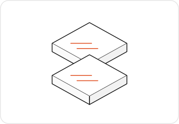
      <br />
      <sub><b>层叠卡片</b> · <code>isometric/48/stack</code></sub>
    </td>
    <td align="center" width="33%">
      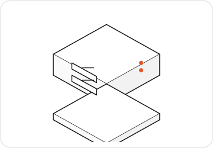
      <br />
      <sub><b>服务器机箱</b> · <code>isometric/48/server</code></sub>
    </td>
    <td align="center" width="33%">
      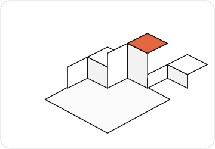
      <br />
      <sub><b>增长柱状图</b> · <code>isometric/48/chart</code></sub>
    </td>
  </tr>
  <tr>
    <td align="center" width="33%">
      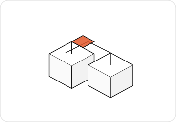
      <br />
      <sub><b>仓储纸箱</b> · <code>isometric/48/boxes</code></sub>
    </td>
    <td align="center" width="33%">
      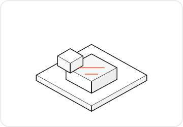
      <br />
      <sub><b>设计师工作台</b> · <code>isometric/48/desk</code></sub>
    </td>
    <td align="center" width="33%">
      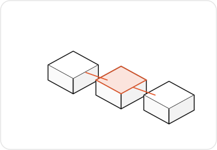
      <br />
      <sub><b>部署流水线</b> · <code>isometric/48/pipeline</code></sub>
    </td>
  </tr>
</table>

### 2. 三大系列叙事插画（Office Club · Notion Club · Ecommerce Club）

<table>
  <tr>
    <td align="center" width="33%">
      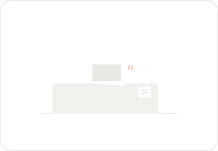
      <br />
      <sub><b>专注办公</b> · 办公室系列（Office Club）</sub>
    </td>
    <td align="center" width="33%">
      
      <br />
      <sub><b>远程白板讨论</b> · 办公室系列（Office Club）</sub>
    </td>
    <td align="center" width="33%">
      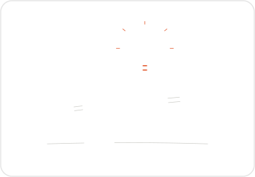
      <br />
      <sub><b>灵光一现</b> · 通用系列（Notion Club）</sub>
    </td>
  </tr>
  <tr>
    <td align="center" width="33%">
      
      <br />
      <sub><b>沉浸阅读</b> · 通用系列（Notion Club）</sub>
    </td>
    <td align="center" width="33%">
      
      <br />
      <sub><b>购物车结账</b> · 电子商务系列（Ecommerce Club）</sub>
    </td>
    <td align="center" width="33%">
      
      <br />
      <sub><b>包裹派送</b> · 电子商务系列（Ecommerce Club）</sub>
    </td>
  </tr>
</table>

### 3. 手绘图标（常规单色 vs 双色 Duotone 实时对照）

每张卡片左侧为 **常规单色（Regular）**，右侧为 **双色高光（Duotone）**，均基于 `24×24` 像素网格绘制：

<table>
  <tr>
    <td align="center">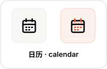</td>
    <td align="center"></td>
    <td align="center">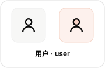</td>
    <td align="center"></td>
    <td align="center">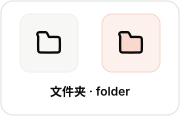</td>
    <td align="center">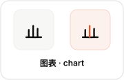</td>
  </tr>
  <tr>
    <td align="center">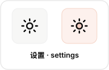</td>
    <td align="center">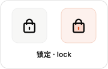</td>
    <td align="center">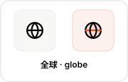</td>
    <td align="center">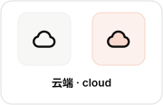</td>
    <td align="center"></td>
    <td align="center">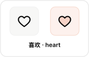</td>
  </tr>
  <tr>
    <td align="center">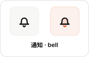</td>
    <td align="center">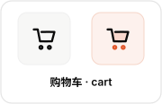</td>
    <td align="center">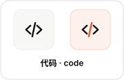</td>
    <td align="center">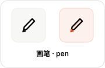</td>
    <td align="center">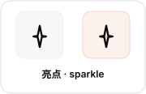</td>
    <td align="center">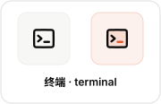</td>
  </tr>
</table>

---

## MCP 服务（Model Context Protocol）详解

Overflow Design 提供官方远程 MCP 服务（基于 HTTP 传输协议），让 **Claude Code、Cursor、VS Code、Codex、Windsurf / Devin、OpenCode** 等 AI 编程助手能够直接按画面语义检索全部 **1,826 张画**，并将最匹配的素材以 **内联 SVG、React JSX 组件或源文件** 的形式直接写入你的代码库。

### 1. 服务概览与权限分级

| 属性 | 说明 |
| :--- | :--- |
| **服务端点（Endpoint）** | `https://www.overflow.design/api/mcp/` |
| **传输协议（Transport）** | MCP Streamable HTTP（远程托管，无需在本地安装 Node/Python 依赖包） |
| **可检索范围** | 全库 **1,826** 张画（支持中英文自然语言语义及关键词检索） |
| **免费层（无需密钥）** | 直接可拉取 **310 张免费画作**（199 个图标 + 71 张立体画静帧 + 40 张插画），零配置即插即用 |
| **Pro 授权层（带密钥）** | 通过请求头传入 `Authorization: Bearer <OVERFLOW_PRO_KEY>` 解锁全部 **1,826 张**画作（含动态立体画与全量插画） |
| **速率限制（Rate Limit）** | 免费层开放检索与免费素材取回；Pro 密钥限速为 **30 张 Pro 素材 / 分钟 / 密钥** |

---

### 2. 三个核心 MCP 工具（Tools）

MCP 服务向 AI 助手暴露三个职责分明的工具，助手会根据你的对话上下文自动按 **「看目录 → 搜画面 → 取素材」** 的顺序调用：

#### ① `list_sets` — 浏览系列与分类目录
列出图标、插画与立体画的全部系列（Sets）、分类（Categories）及数量统计，并标明当前凭证（无密钥或 Pro 密钥）可解锁哪些部分。
- **输入参数**：无
- **典型返回值**：五大系列标识（`icons`、`isometric`、`office-club`、`notion-club`、`ecommerce-club`）、各子分类名称、总数量与当前账户可访问状态。

#### ② `search_drawings` — 按画面内容语义检索
在全部 1,826 张画中按画面内容、物体、动作或情绪检索匹配项。
- **输入参数**：
  - `query`（`string`，必填）：搜索词或画面描述（如 `"calendar"`、`"empty inbox"`、`"server rack"`、`"日历"`、`"结账"`）。
  - `type`（`"icon" | "isometric" | "illustration"`，可选）：限定只搜图标、立体画或插画。
  - `limit`（`number`，可选）：返回结果数量上限。
- **返回结构**：匹配画作列表，每项包含唯一路径 ID（如 `icon/calendar-square`、`isometric/48/calendar`、`illustration/notion-club/calendar`）、名称、所属系列及 `free: boolean`（是否属于免费层）。

#### ③ `get_drawings` — 批量取回 SVG / JSX / 下载链接
根据 `search_drawings` 返回的 `id` 列表，一次性取回最多 **20 张**画作的实际内容。
- **输入参数**：
  - `ids`（`string[]`，必填）：要获取的画作 ID 数组（最多 20 个，例如 `["icon/calendar-square", "icon/user"]`）。
  - `format`（`"svg" | "jsx"`，可选）：指定返回原始 `<svg>` 标签或可直接用于 React 的 JSX 组件源码。
- **交付机制（按资产体积分流）**：
  - **图标与绝大多数静态立体画**：直接在响应体中返回完整、干净的 **SVG 源码或 JSX 代码**，AI 助手可直接内联进组件或保存为 `.svg` / `.tsx` 文件。
  - **复杂叙事插画与多层动态立体画**：返回带签名的临时下载链接（Signed URL，**15 分钟内有效**），供助手通过 `curl` / `fetch` 直接拉取写入本地项目的 `public/` 或 `assets/` 目录。

---

### 3. 各客户端接入配置指南

你可以先不带密钥直接接入（立即使用 310 张免费画作），也可以配置环境变量 `OVERFLOW_PRO_KEY` 解锁全部 1,826 张画作。

#### Claude Code
在终端中运行以下命令后重启会话：

```bash
# 免费直连（无需密钥，可用 310 张免费画作）
claude mcp add --transport http overflow \
  https://www.overflow.design/api/mcp/

# Pro 授权（需先在环境变量中设置 OVERFLOW_PRO_KEY）
claude mcp add --transport http overflow \
  --header "Authorization: Bearer $OVERFLOW_PRO_KEY" \
  https://www.overflow.design/api/mcp/
```

#### Cursor
写入全局 `~/.cursor/mcp.json` 或项目级 `.cursor/mcp.json`（也可在 Cursor 设置的 MCP 面板中添加）：

```json
// 免费直连
{
  "mcpServers": {
    "overflow": {
      "url": "https://www.overflow.design/api/mcp/"
    }
  }
}
```

```json
// Pro 授权
{
  "mcpServers": {
    "overflow": {
      "url": "https://www.overflow.design/api/mcp/",
      "headers": {
        "Authorization": "Bearer ${env:OVERFLOW_PRO_KEY}"
      }
    }
  }
}
```

#### VS Code（GitHub Copilot）
写入工作区的 `.vscode/mcp.json`：

```json
// 免费直连
{
  "servers": {
    "overflow": {
      "type": "http",
      "url": "https://www.overflow.design/api/mcp/"
    }
  }
}
```

```json
// Pro 授权
{
  "servers": {
    "overflow": {
      "type": "http",
      "url": "https://www.overflow.design/api/mcp/",
      "headers": {
        "Authorization": "Bearer ${env:OVERFLOW_PRO_KEY}"
      }
    }
  }
}
```

#### OpenAI Codex CLI
写入 `~/.codex/config.toml`，下一次会话生效：

```toml
# 免费直连
[mcp_servers.overflow]
url = "https://www.overflow.design/api/mcp/"

# Pro 授权（取消下行注释并确保环境中存在 OVERFLOW_PRO_KEY）
# env_http_headers = { "Authorization" = "OVERFLOW_PRO_KEY" }
```

#### Devin / Windsurf
写入 `~/.config/devin/mcp_config.json`（Windsurf 使用相同格式）：

```json
{
  "mcpServers": {
    "overflow": {
      "serverUrl": "https://www.overflow.design/api/mcp/",
      "headers": {
        "Authorization": "Bearer $OVERFLOW_PRO_KEY"
      }
    }
  }
}
```

#### OpenCode
写入项目根目录的 `opencode.json`：

```json
{
  "$schema": "https://opencode.ai/config.json",
  "mcp": {
    "overflow": {
      "type": "remote",
      "url": "https://www.overflow.design/api/mcp/",
      "headers": {
        "Authorization": "Bearer {env:OVERFLOW_PRO_KEY}"
      },
      "enabled": true
    }
  }
}
```

---

### 4. 真实调用流程与 Prompt 示例

接入 MCP 后，你只需用自然语言向代码助手描述界面需求，助手便会自动完成检索、筛选与代码落地：

#### 典型执行链路
1. **用户指令**：「在日期选择器的标签旁加一个 Overflow 的手绘日历图标，16px，跟文字基线对齐。」
2. **步骤一（`search_drawings`）**：助手自动发起 `search_drawings({ query: "calendar" })`（耗时约 `~200ms`），获得候选列表：
   - `isometric/48/calendar`（立体画 · 免费）
   - `icon/calendar`（图标 · 完整版）
   - `illustration/notion-club/calendar`（插画 · 完整版）
   - `icon/calendar-square`（图标 · 免费）
3. **步骤二（`get_drawings`）**：若当前为无密钥模式，助手会自动优先挑选标记为**免费**且符合上下文尺度的 `icon/calendar-square`，调用 `get_drawings({ ids: ["icon/calendar-square"], format: "jsx" })`（耗时约 `~110ms`）。
4. **步骤三（写入组件）**：助手将返回的干净 SVG/JSX 写入项目组件，并自动设置 `className="size-4 text-current"`。

#### 常用 Prompt 模板
- **为组件挑选图标**：「用 Overflow MCP 找三个适合放在『团队权限设置』侧边栏的手绘图标，导出成 React 组件放到 `src/components/icons/`。」
- **为空状态匹配插画**：「订单列表目前缺一个空状态，去 Overflow 电商系列里找一张表示『购物车为空』或『包裹』的插画，放进 `<EmptyOrders />` 组件。」
- **搭建特性区立体画**：「首页架构介绍需要三张等距立体画（服务器、数据分析、云同步），用 Overflow MCP 搜索免费立体画并内联到特性卡片里。」

---

## Figma & FigJam 官方插件

除了面向开发者的 MCP 服务，设计师也可直接在 Figma Community 安装 **Overflow Design 插件**：
- **画布内即时搜索**：按中英文关键词、分类或免费/Pro 状态过滤全部 1,826 张画作。
- **全局样式预设**：拖入画布前即可统一调整常规/双色风格、描边粗细（`1.25px` / `1.5px` / `2px`）与主色调。
- **Auto Layout 原生兼容**：点击或拖拽即可生成标准矢量 Frame，自动适配 Figma 变量（Variables）与组件变体（Variants）。

---

## 免费版与 Pro 授权对比

| 维度 | 免费小样（Free Sample） | 全量授权（Overflow Pro） |
| :--- | :--- | :--- |
| **资产数量** | **310 张**（199 图标 + 71 立体画静帧 + 40 插画） | 全部 **1,826 张**（含可交互立体画代码片段与全套插画） |
| **MCP 服务** | 免密钥直连，无限检索全库并取回 310 张免费画作 | 凭 Pro 密钥取回全部 1,826 张画作（30 张/分钟） |
| **交付格式** | SVG、PNG、JSX、Figma 社区文件 | 完整 Figma 源文件（带变体与关键词）、全量 SVG / PNG / JSX、持续更新 |
| **商业许可** | 可用于个人与商业项目，无需署名 | 无限个人、商业与客户委托交付项目，买断制含后续更新 |

> **禁止事项**：无论是免费版还是 Pro 版，均不可将原始素材重新打包作为独立素材库、图标包、Figma 模板资产或衍生竞争产品进行二次分发或转售。

---

## 官方链接

- **Overflow Design 官网**：[https://www.overflow.design/](https://www.overflow.design/)
- **MCP 官方文档**：[https://www.overflow.design/mcp/](https://www.overflow.design/mcp/)
- **MCP 远程端点**：`https://www.overflow.design/api/mcp/`
- **Figma 官方插件**：[Overflow Icons & Illustrations](https://www.figma.com/community/plugin/1687128231376306385/overflow-icons-illustrations)
- **作者 X（Twitter）**：[@zafarlab](https://x.com/zafarlab)
- **作者 GitHub**：[@Mr-Zafar](https://github.com/Mr-Zafar)
